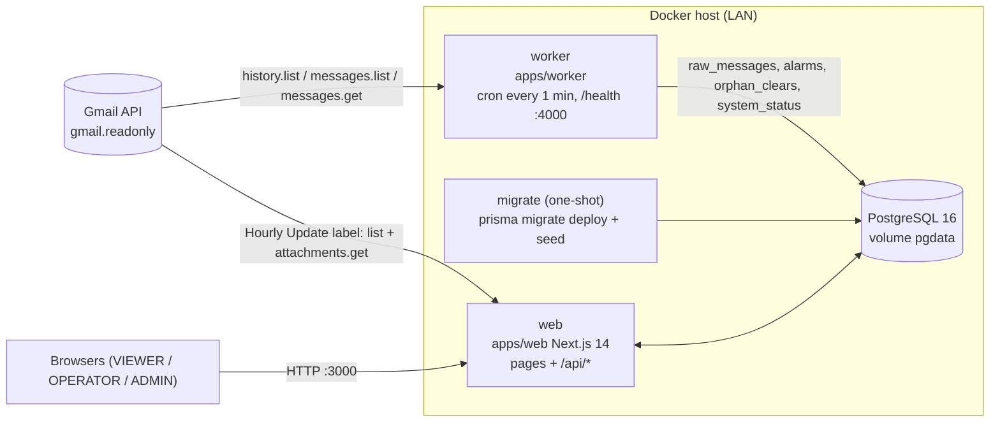

# Alarm Filter — Reverse-Engineered Requirements

> Derived only from what exists in the repository on 2026-10-14 (HEAD `a48b33d` plus uncommitted
> working-tree changes: `SiteMaster.phone`, migration `20261014000000_site_phone`, Site Master
> fields on the alarm pages, per-category WhatsApp images). Every ID cites its evidence.
> Paths are relative to the repo root. "unverified" = read from code but not executed/confirmed.

---

## 1. System overview

Alarm Filter reads mobile-network alarm e-mails from one Gmail mailbox, parses each subject/body,
classifies it (DOWN / POWER / OTHER), pairs each alarm with its later `CLEARED_` e-mail, and shows
active alarms, cleared alarms (with duration) and statistics in a web app. A second, stateless
module lists hourly "Nokia (Down & Environmental)" report e-mails, extracts the attached workbook
(`.rar` or plain `.xlsx`) on demand, enriches rows from an imported Site Master, and offers
filtering, Excel export, comparison of two reports and table images for WhatsApp.
Users are NOC staff on the LAN with roles VIEWER < OPERATOR < ADMIN. Main flows: (1) worker
ingests Gmail every minute → matching engine updates `alarms`; (2) users browse/export alarms;
(3) operators process hourly reports; (4) admins manage rules, users, office, hidden types,
Site Master and normalizations.

Note: the `web` service is not yet defined in `docker-compose.yml` (see §8).

---

## 2. Business requirements

| ID | Requirement | Evidence |
|---|---|---|
| BR-01 | The system exists to turn alarm e-mails in a Gmail mailbox into a list of currently active network alarms. | `apps/worker/src/run.ts` `runOnce`; `apps/web/app/(app)/alarms/page.tsx` |
| BR-02 | The system records when each alarm was cleared and how long it lasted. | `packages/core/src/engine.ts` `handleClear`, `durationMinutes`; `apps/web/app/(app)/cleared/page.tsx` |
| BR-03 | The system classifies alarms into DOWN, POWER and OTHER using admin-editable rules. | `packages/core/src/classify.ts` `classify`; `apps/web/app/api/rules/route.ts` |
| BR-04 | The system provides statistics (active counts, MTTR, daily volume, top sites, sync status). | `apps/web/app/api/stats/*/route.ts`; `apps/web/app/(app)/dashboard/page.tsx` |
| BR-05 | The system scopes all alarm views to one selected office (a Gmail label). | `apps/web/lib/visibility.ts` `alarmScope`; `apps/worker/src/run.ts` office resolution |
| BR-06 | The system lets staff read hourly Nokia report attachments without storing alarm rows. | `packages/core/src/hourly/index.ts` `processReport`; `apps/web/lib/hourly.ts` |
| BR-07 | The system enriches sites with reference data (office, nodality, VIP, battery, phone…) from a Site Master workbook. | `packages/core/src/hourly/siteMaster.ts`; `apps/web/lib/queries.ts` `withSiteInfo` |
| BR-08 | The system restricts access to signed-in users with role-based permissions. | `apps/web/lib/auth.ts`; `apps/web/lib/api.ts` `requireUser`; `apps/web/middleware.ts` |
| BR-09 | The system informs users in the web app about new alarms matching their preferences. | `apps/web/lib/notifications.ts` `notificationFeed`; `apps/web/components/notification-bell.tsx` |
| BR-10 | The system lets users share alarm data outside the app (Excel export, copy-as-table, PNG images). | `apps/web/app/api/export/route.ts`; `packages/core/src/hourly/exportXlsx.ts`; `apps/web/components/hourly/table-image.tsx` |

---

## 3. Functional requirements

Format per FR: **Statement** · Actor · Trigger · Inputs → Outputs · Rules · Evidence · Tests.

### 3.1 Gmail ingestion (worker)

**FR-01** The system shall run one ingestion cycle at start-up and then on the `WORKER_CRON` schedule (default `* * * * *`).
Actor: worker · Trigger: process start / cron · In: — → Out: one `runOnce` call · Rules: a cycle is skipped (logged) while the previous one is still running (`state.running`).
Evidence: `apps/worker/src/index.ts` `tick`, `cron.schedule`; `apps/worker/src/config.ts` `config.cron` · Tests: none.

**FR-02** The system shall discover new messages with `users.history.list` from `system_status.lastHistoryId`, per label id of the label being read.
Actor: worker · Trigger: cycle · In: lastHistoryId, label ids → Out: message ids, max historyId · Rules: historyTypes `messageAdded`,`labelAdded`; `maxResults` 500, paginated; DRAFT/SENT excluded; labelAdded filtered to the read label; HTTP 404 ⇒ `"expired"`.
Evidence: `apps/worker/src/gmail.ts` `historyFor`, `historySince` · Tests: `apps/worker/src/sync.test.ts`.

**FR-03** The system shall fall back to `messages.list` for the last `INITIAL_BACKFILL_HOURS` (default 24) when there is no lastHistoryId, the history is expired, or the selected office changed.
Actor: worker · In: now, backfill hours, `GMAIL_QUERY`, label → Out: ids oldest first · Rules: `currentHistoryId()` captured before listing; query `after:<epoch> (label:…) <GMAIL_QUERY>`; `GMAIL_QUERY` applies only here.
Evidence: `apps/worker/src/sync.ts` `planSync`; `apps/worker/src/gmail.ts` `listSince`; `apps/worker/src/run.ts` (`officeChanged`) · Tests: `sync.test.ts` ("first run falls back…", "404 falls back").

**FR-04** The system shall skip message ids already stored in `raw_messages`.
Rules: lookup in chunks of 1000 (`IN_CHUNK`); insert with `createMany(skipDuplicates)`; `gmailId` is `@unique`.
Evidence: `apps/worker/src/run.ts` `knownIds`, `runOnce`; `packages/db/prisma/schema.prisma` `RawMessage.gmailId` · Tests: `sync.test.ts` ("skips known ids").

**FR-05** The system shall process at most `MAX_MESSAGES_PER_RUN` (default 200) new messages per cycle and advance `lastHistoryId` only when the backlog is drained and fetching was not throttled.
Evidence: `apps/worker/src/sync.ts` `planSync` (`slice(0, maxPerRun)`, `nextHistoryId`); `apps/worker/src/run.ts` (`throttled` ⇒ `nextHistoryId=null`) · Tests: `sync.test.ts` ("caps at maxPerRun and holds historyId until drained").

**FR-06** The system shall fetch each message with `messages.get format:"full"` and store `gmailId`, `subject`, `receivedAt` (= Gmail `internalDate`), plain-text `body` (≤ 20,000 chars) and `office`.
Rules: 5 concurrent fetches (`FETCH_CONCURRENCY`); text/plain preferred, else HTML with tags stripped; 404 ⇒ message skipped; quota errors (429, 403 quota/rate) stop fetching and keep partial results.
Evidence: `apps/worker/src/gmail.ts` `getMeta`, `extractText`; `apps/worker/src/run.ts` `fetchAll`, `isQuotaError` · Tests: `apps/worker/src/fetch.test.ts`.

**FR-07** The system shall read only the selected office label (`system_status.officeLabel`), or the first `GMAIL_LABELS` entry when no office is selected.
Evidence: `apps/worker/src/run.ts` `runOnce` (`office = status.officeLabel ?? defaultLabels[0]`); `apps/worker/src/gmail.ts` `useLabels`, `resolveLabels` · Tests: none.

**FR-08** The system shall refresh the list of office labels (user labels under `OFFICE_LABEL_PARENTS`, default `DN,DS`) into `system_status.availableLabels` at most every 10 minutes.
Rules: failures are logged only. Evidence: `apps/worker/src/run.ts` `refreshLabels`, `LABEL_REFRESH_MS`; `apps/worker/src/gmail.ts` `listLabels` · Tests: none.

**FR-09** The system shall record each cycle's outcome in `system_status` (`lastRunAt`, `lastRunMessages`, `lastError` ≤ 2000 chars, cleared on success).
Evidence: `apps/worker/src/run.ts` `runOnce`, `recordError`; `apps/worker/src/index.ts` `tick` · Tests: none.

### 3.2 Parsing

**FR-10** The system shall parse the HASH subject format `[CLEARED_]<name> on #<site># at |DD-MON-YYYY HH:mm:ss|` into `isClear`, `alarmName`, `nameSuffix`, `site`, `alarmTime`.
Rules: whitespace collapsed; `CLEARED_` case-insensitive; text after `;` → `nameSuffix`; time is wall clock in `ALARM_TZ` (default `Africa/Cairo`, DST-aware) converted to UTC; impossible dates rejected.
Evidence: `packages/core/src/parser.ts` `parseSubject`, `HASH_RE`; `packages/core/src/time.ts` `parseAlarmStamp`, `zonedToUtc` · Tests: `packages/core/src/parser.test.ts` (26).

**FR-11** The system shall build `alarmKey` as `alarmName||site` (plus `||cellName` when the body has a cell) and never include time.
Evidence: `packages/core/src/parser.ts` `makeAlarmKey`, `parseMessage` · Tests: `parser.test.ts`, `body.test.ts`.

**FR-12** The system shall parse the body labels (ALARM NAME, ALARM_START_TIME, NE_name, Alarm_Number, ALARM_SITE, cell name, ALARM_Device, CONSEC_NBR) and use `consecNbr`, `cellName`, `device` only when `CONSEC_NBR` is numeric.
Evidence: `packages/core/src/body.ts` `parseBody`, `LABELS`; `packages/core/src/parser.ts` `parseMessage` · Tests: `packages/core/src/body.test.ts` (7).

**FR-13** The system shall recognise the Huawei subject `Huawei Alram Notify New alarm: <NE>/<alarm>/<severity>` as `format:"HUAWEI"` with `alarmTime: null`, store it in `raw_messages`, and create no alarm.
Evidence: `parser.ts` `HUAWEI_RE`; `engine.ts` `processOne` (outcome `ignored_format`) · Tests: `parser.test.ts`, `engine.test.ts` ("HUAWEI ignored").

**FR-14** The system shall keep unparseable messages in `raw_messages` with `parseError` and mark them processed.
Evidence: `parser.ts` (`"unrecognised subject format"`); `engine.ts` `processOne` → `markProcessed(id, error)` · Tests: `engine.test.ts` (required case 7), `parser.test.ts`.

### 3.3 Classification

**FR-15** The system shall classify an alarm at creation by the first rule (ascending `priority`) whose `pattern` is a case-insensitive substring of `alarmName`, else OTHER.
Evidence: `packages/core/src/classify.ts` `classify`; `engine.ts` `handleAlarm` · Tests: `engine.test.ts` ("classification DOWN/POWER/OTHER").

**FR-16** The system shall seed 13 rules (DOWN: LINK FAILURE, BTS DOWN, CELL UNAVAILABLE, SITE DOWN, UNREACHABLE, NODE DOWN; POWER: MAINS, AC FAIL, BATTERY, RECTIFIER, DC LOW, GENERATOR, POWER) only when `rules` is empty.
Evidence: `packages/db/prisma/seed.ts` `RULES`, `seedRules` · Tests: none.

**FR-17** The system shall let an ADMIN replace all rules (`PUT /api/rules`, ≤ 500 rules, pattern 1–100 chars, priority 0–100000) and re-classify existing alarms in the same transaction.
Evidence: `apps/web/app/api/rules/route.ts` `GET`, `PUT` · Tests: none.

### 3.4 Matching engine

**FR-18** The system shall process pending raw messages ordered by `alarmTime` (or `receivedAt` when absent), alarms before clears, then `receivedAt`, then `gmailId`.
Evidence: `packages/core/src/engine.ts` `sortKey`/`compare`, `processBatch`; `apps/worker/src/run.ts` (pending = `processedAt: null`) · Tests: `engine.test.ts` (out-of-order cases 6a/6b, order independence).

**FR-19** The system shall treat an alarm as a duplicate when its `consecNbr` already exists, or (no consecNbr) when an alarm with the same `alarmKey` and `alarmTime` exists.
Evidence: `engine.ts` `handleAlarm` (`findAlarmByConsec`, `findAlarm`); `schema.prisma` `Alarm.consecNbr @unique` · Tests: `engine.test.ts` (case 4, "same consec is a duplicate").

**FR-20** The system shall, for a body-less alarm, close older ACTIVE body-less alarms with the same key as `AUTO_SUPERSEDED` at the new alarm's time, and create an older late alarm already CLEARED/AUTO_SUPERSEDED when a newer one is active.
Rules: alarms with `consecNbr` never supersede and are never superseded.
Evidence: `engine.ts` `handleAlarm`, `supersede` · Tests: `engine.test.ts` (case 3, "older alarm arriving late…", CONSEC_NBR "no supersede").

**FR-21** The system shall close the matching ACTIVE alarm on a Clear with `status=CLEARED`, `clearType=EMAIL`, `clearTime` = the Clear's `receivedAt`, `durationMin = max(0, round((clearTime − alarmTime)/60000))`.
Rules: with consecNbr → exactly that alarm; without → exact key+time, else latest ACTIVE for the key; target already closed → `stale_clear` (no-op).
Evidence: `engine.ts` `handleClear`, `durationMinutes` · Tests: `engine.test.ts` (cases 1, 2, "duplicate Clear is a no-op", "negative duration clamped").

**FR-22** The system shall store a Clear without a target in `orphan_clears` and consume it when the matching alarm arrives (same consecNbr, or same key + subject time), creating that alarm CLEARED/EMAIL.
Evidence: `engine.ts` `handleClear`, `findOrphanFor`; `packages/db/src/repository.ts` `createOrphanClear` · Tests: `engine.test.ts` (case 5, case 6, "orphan consumed by consec").

**FR-23** The system shall tag every raw message, alarm and orphan clear with the office label being read.
Evidence: `apps/worker/src/run.ts` (`office` on createMany); `engine.ts` (office from raw message) · Tests: `engine.test.ts` ("office tagging").

**FR-24** The system shall let an ADMIN request `reprocess(days)` (1–90, default 7) that the worker executes on its next cycle: delete alarms with `alarmTime ≥ since`, reopen alarms with `clearTime ≥ since`, delete orphan clears from that window, re-run all raw messages received since then.
Rules: runs inside a transaction holding advisory lock 42 (timeout 30 min); `reprocessDays` reset to null; idempotent.
Evidence: `apps/web/app/api/reprocess/route.ts` `POST` (202); `apps/worker/src/run.ts`; `engine.ts` `reprocess`; `packages/db/src/repository.ts` `resetWindow`, `rawMessagesSince` · Tests: `engine.test.ts` (reprocess ×2), `packages/db/src/repository.test.ts`.

### 3.5 Authentication and users

**FR-25** The system shall authenticate users with e-mail + password (NextAuth Credentials), case-insensitive e-mail, bcrypt comparison, JWT session of 12 h carrying `id` and `role`.
Evidence: `apps/web/lib/auth.ts` `authOptions`; `apps/web/app/login/page.tsx` · Tests: none.

**FR-26** The system shall redirect unauthenticated page requests to `/login` and return 401 JSON for unauthenticated API calls (except `/api/health`, `/api/auth/*`).
Evidence: `apps/web/middleware.ts` (matcher); `apps/web/app/(app)/layout.tsx`; `apps/web/lib/api.ts` `requireUser`, `handler` · Tests: `api.integration.test.ts` ("401 without a session" ×2).

**FR-27** The system shall enforce the role order VIEWER < OPERATOR < ADMIN and return 403 when a route's minimum role is not met.
Evidence: `apps/web/lib/auth.ts` `ROLE_RANK`, `hasRole`; `lib/api.ts` `requireUser` · Tests: `hourly.integration.test.ts` (OPERATOR → 403 on import, VIEWER → 403 on process).

**FR-28** The system shall let an ADMIN list, create (password 8–200 chars, bcrypt 12 rounds), change role/password, and delete users, but not delete themselves or set their own role to VIEWER.
Evidence: `apps/web/app/api/users/route.ts` `GET`/`POST`/`PATCH`/`DELETE` · Tests: none.

**FR-29** The system shall create the initial ADMIN from `ADMIN_EMAIL`/`ADMIN_PASSWORD` once (never overwritten; skipped if password < 8 chars).
Evidence: `packages/db/prisma/seed.ts` `seedAdmin` · Tests: none.

### 3.6 Alarm lists and export

**FR-30** The system shall list ACTIVE alarms newest first, filterable by `category`, `site` (substring), `region`, `minHours`, paginated (`pageSize` 1–500, default 50).
Evidence: `apps/web/app/api/alarms/active/route.ts` `GET`; `apps/web/lib/queries.ts` `activeQuery`, `activeWhere` · Tests: `api.integration.test.ts` (5 cases).

**FR-31** The system shall list CLEARED alarms by `clearTime` desc within `from`–`to` (default last 24 h), filterable by category/site/region.
Evidence: `apps/web/app/api/alarms/cleared/route.ts`; `lib/queries.ts` `clearedWhere` · Tests: none.

**FR-32** The system shall add Site Master data to each listed alarm by joining `siteCodeOf(site)` (last `_` segment matching `^[0-9A-Z]{3,6}[A-Z]{2}$`) to `site_master.code`: `siteCode`, `vip`, `nodality`, `battery`, `phone`, `siteType`, `powerSource` (null when not imported).
Evidence: `apps/web/lib/queries.ts` `withSiteInfo`; `packages/core/src/hourly/types.ts` `siteCodeOf`, `SITE_CODE_RE` · Tests: `api.integration.test.ts` ("adds VIP / nodality / battery / phone…"), `packages/core/src/hourly/siteMaster.test.ts` (`siteCodeOf`).

**FR-33** The system shall show `/alarms` with a live age column (re-render 30 s), auto-refresh every 60 s, and highlight rows older than `ALERT_HOURS` (default 4).
Evidence: `apps/web/app/(app)/alarms/page.tsx` (`useNow(30_000)`, `usePoll(…, 60_000)`, `isAlert`) · Tests: none.

**FR-34** The system shall show a VIP badge next to the site and Nodality, Battery and Phone (`tel:` links) columns on `/alarms` and `/cleared`, and the same data on mobile cards.
Evidence: `apps/web/components/alarm-bits.tsx` `SiteCell`, `siteMasterColumns`, `PhoneLink`, `AlarmCard`; `alarms/page.tsx`; `cleared/page.tsx` · Tests: none (UI).

**FR-35** The system shall export active or cleared alarms (same filters) to `.xlsx` with alarm, site, cell, device, CONSEC_NBR, region, Site Master columns, times in `ALARM_TZ`, and age or clear time/duration/type.
Rules: > 50,000 rows ⇒ 413. Evidence: `apps/web/app/api/export/route.ts` `GET`, `MAX_ROWS`, `local` · Tests: none.

### 3.7 Dashboard and statistics

**FR-36** The system shall return a summary: active counts per category, overdue count (> `ALERT_HOURS`), MTTR per category (avg `durationMin` of EMAIL clears in the last `days`, default 30), last-24 h cleared / orphan / parse-error counts, office and last worker run.
Evidence: `apps/web/app/api/stats/summary/route.ts` · Tests: `api.integration.test.ts` ("returns active counts, MTTR…", "summary counts exclude hidden types").

**FR-37** The system shall return daily counts per category for 1–365 days (default 30) bucketed by local day in `ALARM_TZ`.
Evidence: `apps/web/app/api/stats/daily/route.ts` `localDay` · Tests: none.

**FR-38** The system shall return the top sites (limit 1–100, default 10; days default 30) with total, active and region.
Evidence: `apps/web/app/api/stats/top-sites/route.ts` · Tests: none.

**FR-39** The system shall show a dashboard with counters, a 30-day stacked bar, top-10 sites, MTTR, and a sync bar that turns red when the last run is older than 300 s or has an error.
Evidence: `apps/web/app/(app)/dashboard/page.tsx` (`STALE_SEC`, `SyncBar`) · Tests: none.

### 3.8 Office scope and hidden alarm types

**FR-40** The system shall let an ADMIN select one office from `availableLabels` (`PUT /api/settings/office`) and scope every alarm list, stat, export and notification feed to it.
Evidence: `apps/web/app/api/settings/office/route.ts`; `apps/web/lib/office.ts` `getOffice`; `apps/web/lib/visibility.ts` `alarmScope`, `alarmScopeSql` · Tests: none (office); scope covered indirectly by `api.integration.test.ts`.

**FR-41** The system shall let an ADMIN hide categories and exact alarm names for all users (`system_status.displayFilter`).
Evidence: `apps/web/app/api/settings/display/route.ts`; `lib/visibility.ts` `getDisplayFilter`, `normalizeDisplayFilter` · Tests: `api.integration.test.ts` ("hidden category and hidden names disappear…").

**FR-42** The system shall let every user hide categories and alarm names from their own views (`users.displayPrefs`), merged with the admin list; user filters cannot un-hide.
Evidence: `apps/web/app/api/me/display/route.ts`; `lib/visibility.ts` `effectiveDisplayFilter` · Tests: `api.integration.test.ts` ("hide only for the user who chose them").

**FR-43** The system shall list alarm names of the last 30 days in the current office (≤ 300, most frequent first) with hidden flags.
Evidence: `apps/web/app/api/alarm-names/route.ts` · Tests: none.

### 3.9 Notifications (in-site)

**FR-44** The system shall compute a notification feed on read: alarms with `createdAt` in the last 24 h within the user's scope matching their prefs (≤ 50 items, scan ≤ 2000), unread = `createdAt > notificationsSeenAt` (first time: last 30 min).
Evidence: `apps/web/lib/notifications.ts` `notificationFeed` (`WINDOW_MS`, `FEED_LIMIT`, `SCAN_LIMIT`, `FIRST_SEEN_MS`); `apps/web/app/api/notifications/route.ts` · Tests: `packages/core/src/notify.test.ts` (matching only).

**FR-45** The system shall store per-user notification prefs (enabled, sound, categories, exact alarm names, site substrings; OR within a filter, AND across; default DOWN only).
Evidence: `apps/web/app/api/me/notification-prefs/route.ts`; `packages/core/src/notify.ts` `DEFAULT_NOTIFY_PREFS`, `normalizePrefs`, `matchesPrefs` · Tests: `notify.test.ts` (9).

**FR-46** The system shall poll the feed every 30 s and show a badge, pop-up cards, an optional beep and "(n)" in the tab title; "Mark all read" sets `notificationsSeenAt`.
Evidence: `apps/web/components/notification-bell.tsx`; `apps/web/app/api/notifications/read/route.ts` · Tests: none.

### 3.10 Hourly reports

**FR-47** The system shall list Gmail messages with label `HOURLY_GMAIL_LABEL` (default "Hourly Update") that have an attachment, 25 per page, with cache status, without downloading attachments.
Evidence: `apps/web/app/api/hourly-reports/route.ts`; `apps/web/lib/gmail.ts` `createGmailHourlySource.list` · Tests: `hourly.integration.test.ts` ("lists reports…").

**FR-48** The system shall choose the report attachment as the first `.rar`, else the first `.xlsx`, else the first attachment.
Evidence: `apps/web/lib/gmail.ts` `attachmentOf` · Tests: none (mock source in `hourly.integration.test.ts` serves files directly).

**FR-49** The system shall let an OPERATOR start processing a report (`POST …/process`, 202; 200 if already done unless `force`).
Evidence: `apps/web/app/api/hourly-reports/[gmailId]/process/route.ts`; `apps/web/lib/hourly.ts` `startProcessing` · Tests: `hourly.integration.test.ts`.

**FR-50** The system shall validate a `.rar` attachment: extension `.rar`, size ≤ `HOURLY_MAX_RAR_MB` (25), signature `52 61 72 21 1A 07`.
Evidence: `packages/core/src/hourly/validate.ts` `validateRar`, `RAR_MAGIC` · Tests: `validate.test.ts`.

**FR-51** The system shall pre-check RAR headers (≤ 20 entries, safe relative names, declared size ≤ `HOURLY_MAX_EXTRACT_MB` (100), exactly one `.xlsx`), extract into a fresh temp dir with official `unrar x -o+ -p- -y` (120 s) or node-unrar-js, post-check the disk (no links, nothing outside the dir, limits), and always delete the temp dir.
Evidence: `packages/core/src/hourly/extract.ts` `checkEntries`, `extractXlsx`, `unrarCliBackend`, `unrarJsBackend`, `walkChecked`; `validate.ts` `assertSafeEntryName` · Tests: `extract.test.ts` (6), `validate.test.ts`.

**FR-52** The system shall accept a plain `.xlsx` attachment after checking extension, size ≤ `HOURLY_MAX_RAR_MB`, ZIP signature `50 4B 03 04`, and declared uncompressed size ≤ `HOURLY_MAX_EXTRACT_MB`, without a temp dir.
Evidence: `validate.ts` `attachmentKind`, `validateXlsx`, `zipUncompressedSize`; `hourly/index.ts` `processReport` · Tests: `packages/core/src/hourly/process.test.ts` (4).

**FR-53** The system shall read sheets `2G_Down, 3G_Down, 4G_Down, 5G_Down, Environmental, HW` (never `All`), require columns Alarm Time, Alarm Text, Distinguished Name, Site Code, and dedupe `*_Down` rows on (DN, Alarm Text, Alarm Time) collecting `technologies[]`.
Evidence: `packages/core/src/hourly/parse.ts` `parseReport`, `readSheet`, `REQUIRED`; `types.ts` `HOURLY_SHEETS` · Tests: `parse.test.ts` (7).

**FR-54** The system shall take the Environmental alarm name from Supplementary Information (fallback Alarm Text), keep Alarm Time as wall clock, and flag year < 2020 as `clockInvalid` while keeping the row.
Evidence: `parse.ts` `readSheet`, `alarmTimeText` · Tests: `parse.test.ts`.

**FR-55** The system shall enrich rows from Site Master by Site Code (office, nodality, VIP, site type, power source, battery, phone), derive region (last 2 chars) and category (`*_Down` → DOWN; Environmental with RECTIFIER|MAIN POWER|BATTERY|GENERATOR|SURGE → POWER; else OTHER), and count unmatched and empty codes.
Evidence: `packages/core/src/hourly/enrich.ts` `enrichRows`; `types.ts` `regionOf`, `hourlyCategory` · Tests: `enrich.test.ts` (4).

**FR-56** The system shall apply normalization rules (base: collapse spaces, trim, upper-case; then whole-token replacements per field or `*`, longest first; alarmName rules also apply to Alarm Text and Supplementary Information).
Evidence: `packages/core/src/hourly/normalize.ts` `baseNormalize`, `compileNormalizer`, `FIELD_ALIASES`, `DEFAULT_HOURLY_NORMALIZATIONS` · Tests: `normalize.test.ts` (5).

**FR-57** The system shall cache processed reports in memory per web instance (TTL `HOURLY_CACHE_MIN`, default 30 min; max 20; LRU; shared in-flight promise) and re-process a cold, previously processed report transparently.
Evidence: `apps/web/lib/hourlyCache.ts` `ReportCache`; `apps/web/lib/hourly.ts` `getReport` · Tests: `apps/web/lib/hourlyCache.test.ts` (5).

**FR-58** The system shall return 409 to a VIEWER for a report never processed in this instance, and 422 with an error code for an invalid report.
Evidence: `apps/web/lib/hourly.ts` `getReport`; `validate.ts` `HourlyReportError` codes · Tests: `hourly.integration.test.ts` (VIEWER → 409).

**FR-59** The system shall serve report rows with filters (sheet, region, office, alarm, siteType, category, vip, from, to, q), sort, paging (`limit` 1–500) and optional facets.
Evidence: `apps/web/app/api/hourly-reports/[gmailId]/rows/route.ts`; `lib/hourly.ts` `parseFilters`; `packages/core/src/hourly/filter.ts` `filterHourlyRows`, `sortHourlyRows`, `hourlyFacets` · Tests: `filter.test.ts` (8), `hourly.integration.test.ts`.

**FR-60** The system shall export filtered report rows to `.xlsx` with the requested columns in order, office row fills, frozen bold header and autofilter.
Evidence: `apps/web/app/api/hourly-reports/[gmailId]/export/route.ts`; `packages/core/src/hourly/exportXlsx.ts` `buildHourlyXlsx` · Tests: `exportXlsx.test.ts` (2), `hourly.integration.test.ts`, `apps/web/e2e/hourly.spec.ts`.

**FR-61** The system shall compare two reports and return new and disappeared rows keyed by `code|alarmName|dn` (time ignored).
Evidence: `apps/web/app/api/hourly-reports/diff/route.ts`; `packages/core/src/hourly/diff.ts` `diffHourly`, `hourlyDiffKey`; `apps/web/app/(app)/hourly/compare/page.tsx` · Tests: `filter.test.ts` ("diff ignores time"), `hourly.integration.test.ts` (a = b → 400).

**FR-62** The system shall show the report table with sheet tabs, multi-select filters kept in the URL, column chooser (localStorage `hourly.columns.v1`), virtualised rows coloured by office, and "Copy as table" (TSV + HTML).
Evidence: `apps/web/app/(app)/hourly/[gmailId]/page.tsx`; `apps/web/components/hourly/hourly-table.tsx` `HourlyTable`, `useColumnPrefs`, `copyRows`; `components/hourly/client.ts` `useHourlyUrl` · Tests: `e2e/hourly.spec.ts`.

**FR-63** The system shall render the filtered rows as PNG images (compact or visible columns; 25/40/60/100 rows per image, default 40; separate image sets per category DOWN/POWER/OTHER by default) and offer Share (Web Share API with files), Download and Copy image.
Evidence: `apps/web/components/hourly/table-image.tsx` `TableImageButton`, `renderPage`, `COMPACT_COLUMNS`, `filterSummary` · Tests: `e2e/hourly.spec.ts` (image step).

**FR-64** The system shall poll the report list every 60 s, every 2 s while a report is processing, and show Process/Retry only to OPERATOR and ADMIN.
Evidence: `apps/web/app/(app)/hourly/page.tsx` · Tests: `e2e/hourly.spec.ts` (process path).

### 3.11 Site Master and normalizations

**FR-65** The system shall let an ADMIN import a Site Master `.xlsx` (≤ 5 MB) and upsert by Code, returning inserted / updated / skipped.
Rules: sheet `SiteMaster` (else name match, else first sheet); required Code + Office; skip invalid code, duplicate code in file, empty office; office base-normalised; VIP `y|yes|true|1|vip`; region from code; the hourly cache is cleared.
Evidence: `apps/web/app/api/site-master/import/route.ts`; `packages/core/src/hourly/siteMaster.ts` `parseSiteMasterXlsx` · Tests: `hourly.integration.test.ts` (136 inserted / 2 skipped), `enrich.test.ts`.

**FR-66** The system shall read the phone from Guard Number / Guard Phone / Phone / Phone Number / Mobile / Contact, restoring the leading 0 dropped by Excel and joining several numbers with " / ".
Evidence: `siteMaster.ts` `COLS.phone`, `phoneText`; `schema.prisma` `SiteMaster.phone`; migration `20261014000000_site_phone` (uncommitted) · Tests: `siteMaster.test.ts`.

**FR-67** The system shall list Site Master rows to any signed-in user (filter office, q; paginated) and let an ADMIN edit one site (`PUT /api/site-master/{code}`, phone limited to `[\d+ /()-]`).
Evidence: `apps/web/app/api/site-master/route.ts`, `[code]/route.ts`; `apps/web/app/(app)/settings/site-master/page.tsx` (inline edit of office, site type, phone) · Tests: `hourly.integration.test.ts` (search, PUT siteType).

**FR-68** The system shall let an ADMIN read and replace hourly normalization rules (≤ 500; field `*` or a normalized field), clearing the hourly cache.
Evidence: `apps/web/app/api/hourly-normalizations/route.ts` · Tests: none (route); `normalize.test.ts` (logic).

### 3.12 Health

**FR-69** The worker shall expose `GET /health` on `WORKER_HEALTH_PORT` (4000) returning 503 when the last run is older than `HEALTH_STALE_AFTER_SEC` (300 s, after a start-up grace) or the DB fails, and 200 otherwise (Gmail errors reported in the body).
Evidence: `apps/worker/src/health.ts` `startHealthServer` · Tests: none.

**FR-70** The web app shall expose public `GET /api/health`: 503 when `SELECT 1` fails, else 200 with worker freshness (`WORKER_STALE_SEC` 300) in the body.
Evidence: `apps/web/app/api/health/route.ts` · Tests: none.

---

## 4. Non-functional requirements

### Performance
| ID | Requirement (value) | Evidence |
|---|---|---|
| NFR-01 | Ingestion cycle every 1 min (`WORKER_CRON` `* * * * *`). | `apps/worker/src/config.ts` |
| NFR-02 | ≤ 200 messages per cycle (`MAX_MESSAGES_PER_RUN`). | `config.ts`; `sync.ts` `planSync` |
| NFR-03 | 5 concurrent Gmail `messages.get` calls. | `run.ts` `FETCH_CONCURRENCY` |
| NFR-04 | Processing transaction timeout 5 min (maxWait 60 s); reprocess 30 min. | `run.ts` |
| NFR-05 | API page size ≤ 500 (default 50); hourly rows `limit` ≤ 500; hourly list 25/page. | `lib/api.ts` `pagination`; `rows/route.ts`; `hourly-reports/route.ts` |
| NFR-06 | UI refresh: alarms/cleared 60 s, age 30 s, dashboard summary 60 s and charts 5 min, bell 30 s, hourly list 60 s (2 s while processing), status wait 1.5 s. | page/components files cited in FR-33, FR-39, FR-46, FR-64; `components/hourly/client.ts` `waitForReport` |
| NFR-07 | Hourly table virtualised (row height 34, overscan 15). | `components/hourly/hourly-table.tsx` |
| NFR-08 | Hourly cache: TTL 30 min, 20 reports, per instance. | `lib/hourly.ts`; `lib/hourlyCache.ts` |
| NFR-09 | Export cap 50,000 alarm rows (413 above). | `app/api/export/route.ts` `MAX_ROWS` |

### Reliability
| ID | Requirement (value) | Evidence |
|---|---|---|
| NFR-10 | One ingestion cycle at a time: in-process `running` flag + `pg_advisory_xact_lock(42)`. | `apps/worker/src/index.ts` `tick`; `run.ts` `LOCK_ID` |
| NFR-11 | Idempotent ingest: `raw_messages.gmailId @unique`, `createMany(skipDuplicates)`. | `schema.prisma`; `run.ts` |
| NFR-12 | No message loss on the per-run cap or quota throttling: `lastHistoryId` advances only when drained and unthrottled. | `sync.ts`; `run.ts` |
| NFR-13 | `reprocess` is deterministic/idempotent (two runs → identical state). | `engine.test.ts`; `repository.test.ts` |
| NFR-14 | Graceful shutdown on SIGTERM/SIGINT: waits ≤ 25 s for a running cycle. | `index.ts` `shutdown` |
| NFR-15 | Worker errors recorded in `lastError` without crashing; health stays 200 on Gmail errors to avoid restart loops. | `run.ts` `recordError`; `health.ts` |
| NFR-16 | Containers restart `unless-stopped` (db, worker); migrate runs once. | `docker-compose.yml` |

### Security
| ID | Requirement (value) | Evidence |
|---|---|---|
| NFR-17 | All pages require a session; all APIs except health/auth return 401 without one. | `middleware.ts`; `(app)/layout.tsx`; `lib/api.ts` |
| NFR-18 | Role checks server-side: OPERATOR for hourly processing; ADMIN for rules, reprocess, users, office, display, Site Master import/edit, normalizations. | route files cited in FR-17, FR-24, FR-28, FR-40, FR-41, FR-49, FR-65, FR-67, FR-68 |
| NFR-19 | Passwords stored as bcrypt hashes (12 rounds); min length 8. | `app/api/users/route.ts`; `seed.ts` |
| NFR-20 | JWT sessions, max age 12 h. | `lib/auth.ts` |
| NFR-21 | Gmail access read-only (`gmail.readonly`); OAuth files mounted read-only. | `scripts/lib/google.ts` `SCOPES`; `docker-compose.yml` worker volumes |
| NFR-22 | Secrets excluded from git and images (`credentials.json`, `token.json`, `.env*`, `data/`, `samples/`, fixtures). | `.gitignore`; `.dockerignore` |
| NFR-23 | All API inputs validated with zod (400 with flattened errors); hourly report id `^[A-Za-z0-9_-]{6,64}$`. | `lib/api.ts` `parseQuery`, `parseBody`; `lib/hourly.ts` `checkGmailId` |
| NFR-24 | Attachment safety: signature, size, entry count, path traversal, links, declared + on-disk size, single workbook, temp dir always removed, nothing executed. | `validate.ts`; `extract.ts` |
| NFR-25 | Uploads limited: Site Master `.xlsx` ≤ 5 MB. | `site-master/import/route.ts` |
| NFR-26 | Containers run as non-root `node`; db port not published (dev override binds 127.0.0.1 only). | Dockerfiles; `docker-compose.yml`; `docker-compose.dev.yml` |

### Data
| ID | Requirement (value) | Evidence |
|---|---|---|
| NFR-27 | Every Gmail message is kept in `raw_messages` (source of truth for reprocess); unparseable ones are never dropped. | `schema.prisma` `RawMessage` comment; `engine.ts` |
| NFR-28 | Hourly alarm rows are never persisted; only `site_master` and `hourly_normalizations`. | `hourly/index.ts`; `lib/hourly.ts` |
| NFR-29 | Times stored in UTC; displayed/exported in `ALARM_TZ` (default Africa/Cairo); DB container `TZ=UTC`. | `time.ts`; `lib/api.ts` `ALARM_TZ`; `export/route.ts` `local`; `docker-compose.yml` |
| NFR-30 | Postgres data in named volume `pgdata`. | `docker-compose.yml` |
| NFR-31 | Seed is idempotent (rules/normalizations only when empty; admin never overwritten). | `seed.ts` |

### Operability
| ID | Requirement (value) | Evidence |
|---|---|---|
| NFR-32 | Deployment via Docker Compose: `db` (healthcheck `pg_isready` 5 s), `migrate` (one-shot), `worker` (healthcheck wget `/health` 30 s). | `docker-compose.yml` |
| NFR-33 | Web image: `node:20-bookworm-slim`, official `unrar` from Debian non-free, standalone Next.js, healthcheck `/api/health` 30 s. | `apps/web/Dockerfile` |
| NFR-34 | Configuration via env variables (see §6); integers validated at start-up. | `apps/worker/src/config.ts` `int()` |
| NFR-35 | Worker logs one summary line per cycle (office, mode, fetched, backlog, outcome counts). | `apps/worker/src/index.ts` `tick` |

### Compatibility
| ID | Requirement (value) | Evidence |
|---|---|---|
| NFR-36 | Node ≥ 20 (`engines`); images on Node 20; pnpm 9.15.9 via corepack. | root `package.json`; Dockerfiles |
| NFR-37 | Responsive UI: card views below `md` for alarm lists; collapsible filter bar below `sm`. | `components/data-table.tsx` `renderCard`; `components/filters.tsx` `FilterBar` |
| NFR-38 | Share-to-WhatsApp requires Web Share API with files (secure context); clipboard image copy requires a secure context; otherwise download. | `components/hourly/table-image.tsx` |
| NFR-39 | English UI; numbers rendered with `en-US`, phone numbers `dir="ltr"`. | pages using `toLocaleString("en-US")`; `alarm-bits.tsx` `PhoneLink` |

### Maintainability
| ID | Requirement (value) | Evidence |
|---|---|---|
| NFR-40 | Monorepo: `apps/web`, `apps/worker`, `packages/core` (pure logic, browser-safe root export + server `./hourly` entry), `packages/db`. | `pnpm-workspace.yaml`; `packages/core/package.json` `exports` |
| NFR-41 | Unit/integration tests with Vitest (`packages/*/src`, `apps/worker/src`, `apps/web/{app,lib}`); DB tests only against `alarms_test` via `TEST_DATABASE_URL`. | `vitest.config.ts`; `api.integration.test.ts`; `e2e/db.mjs` |
| NFR-42 | One Playwright smoke test for hourly reports (`next dev` :3200, mock Gmail dir). | `apps/web/playwright.config.ts`; `e2e/hourly.spec.ts` |
| NFR-43 | TypeScript strict (`strict`, `noUncheckedIndexedAccess`); Prettier + ESLint. | `tsconfig.base.json`; `.prettierrc.json`; `eslint.config.mjs` |

---

## 5. Data model summary (`packages/db/prisma/schema.prisma`)

Enums: `Category {DOWN, POWER, OTHER}`, `AlarmStatus {ACTIVE, CLEARED}`, `ClearType {EMAIL, AUTO_SUPERSEDED}`, `Role {VIEWER, OPERATOR, ADMIN}`.

| Model → table | Key | Unique | Indexes | Notable fields |
|---|---|---|---|---|
| RawMessage → `raw_messages` | id (serial) | gmailId | receivedAt; office | subject, receivedAt, body?, office?, parseError?, processedAt? |
| Alarm → `alarms` | id (serial) | consecNbr | (alarmKey, alarmTime); (status, category); (office, status); site | alarmName, site, category, alarmTime, status (default ACTIVE), clearTime?, durationMin?, clearType?, cellName?, device?, office?, createdAt |
| OrphanClear → `orphan_clears` | id (serial) | — | alarmKey; consecNbr | subject, clearTime, rawMessageId → RawMessage (onDelete Cascade), consecNbr?, office? |
| Rule → `rules` | id (serial) | — | priority | pattern, category, priority |
| Site → `sites` | site | — | — | region?, owner? |
| User → `users` | id (serial) | email | — | passwordHash, role (default VIEWER), notifyPrefs Json?, notificationsSeenAt?, displayPrefs Json? |
| SystemStatus → `system_status` | id (default 1) | — | — | lastHistoryId?, lastRunAt?, lastError?, lastRunMessages (0), reprocessDays?, officeLabel?, syncedLabel?, availableLabels Json?, displayFilter Json? |
| SiteMaster → `site_master` | code | — | office | siteName?, office, nodality?, vip (false), siteType?, powerSource?, battery?, phone? (uncommitted), region?, notes?, updatedAt |
| HourlyNormalization → `hourly_normalizations` | id (serial) | (field, from) | — | field (`*` = all), from, to |

Only relation: OrphanClear → RawMessage. `Alarm.site` has no FK to Site/SiteMaster.
Migrations: `20261011000000_init`, `20261011200000_body_consec`, `20261012000000_office`, `20261012010000_notifications`, `20261012020000_display_filter`, `20261012030000_user_display_prefs`, `20261013000000_hourly`, `20261014000000_site_phone` (untracked).

---

## 6. External interfaces

**Gmail API** (account per CLAUDE.md: Workspace mailbox; OAuth Desktop client, scope `https://www.googleapis.com/auth/gmail.readonly` — `scripts/lib/google.ts`).
- Worker: `users.history.list`, `users.messages.list`, `users.messages.get (full)`, `users.getProfile`, `users.labels.list` — `apps/worker/src/gmail.ts`.
- Web: `users.messages.list` (label + `has:attachment`), `users.messages.get`, `users.messages.attachments.get` — `apps/web/lib/gmail.ts`.
- Attachments: `.rar` (RAR4/5) containing one `.xlsx`, or a plain `.xlsx` — §3.10.
- Libraries: `@googleapis/gmail`, `google-auth-library`.

**Other third parties:** none at runtime (no cloud services, no push providers). Official RarLab `unrar` binary in the web image; `node-unrar-js` fallback.

**Environment variables** (names and purpose only):

| Name | Purpose | Used in |
|---|---|---|
| POSTGRES_USER / POSTGRES_PASSWORD / POSTGRES_DB | DB credentials/name | `docker-compose.yml` |
| DATABASE_URL | Prisma connection | `schema.prisma`; compose |
| NEXTAUTH_SECRET / NEXTAUTH_URL | NextAuth (read implicitly) | `.env.example`; next-auth |
| ADMIN_EMAIL / ADMIN_PASSWORD | Initial admin | `packages/db/prisma/seed.ts` |
| ALARM_TZ | Alarm time zone (default Africa/Cairo) | `apps/worker/src/config.ts`; `apps/web/lib/api.ts`; `(app)/layout.tsx` |
| ALERT_HOURS | Overdue threshold (default 4) | `(app)/layout.tsx`; `api/stats/summary/route.ts` |
| GMAIL_QUERY | Extra filter for fallback listing | `config.ts`; `gmail.ts` `listSince` |
| GMAIL_LABELS | Default label when no office selected | `config.ts`; `run.ts` |
| OFFICE_LABEL_PARENTS | Parents of office labels (default DN,DS) | `config.ts` |
| GOOGLE_TOKEN_PATH / GOOGLE_CREDENTIALS_PATH | OAuth file paths | `config.ts`; `apps/web/lib/gmail.ts` |
| WORKER_CRON | Cycle schedule | `config.ts` |
| WORKER_HEALTH_PORT | Worker health port (4000) | `config.ts` |
| MAX_MESSAGES_PER_RUN | Per-cycle cap (200) | `config.ts` |
| INITIAL_BACKFILL_HOURS | Fallback window (24) | `config.ts` |
| HEALTH_STALE_AFTER_SEC | Worker staleness (300) | `config.ts` |
| HOURLY_GMAIL_LABEL | Hourly report label | `apps/web/lib/gmail.ts` |
| HOURLY_MAX_RAR_MB / HOURLY_MAX_EXTRACT_MB | Attachment / extracted size limits | `packages/core/src/hourly/validate.ts` `limitsFromEnv` |
| HOURLY_CACHE_MIN | Report cache TTL | `apps/web/lib/hourly.ts` |
| HOURLY_GMAIL_MOCK_DIR | Dev/test: local files instead of Gmail | `apps/web/lib/gmail.ts` |
| HOURLY_UNRAR_BIN | Path to `unrar` | `packages/core/src/hourly/extract.ts` |
| NEXT_DIST_DIR | Alternate Next build dir | `apps/web/next.config.mjs` |
| TEST_DATABASE_URL | Integration/e2e DB (`alarms_test`) | test files; `playwright.config.ts` |

---

## 7. Traceability matrix

| FR | Main files | Tests |
|---|---|---|
| FR-01 | apps/worker/src/index.ts, config.ts | none |
| FR-02 | apps/worker/src/gmail.ts | sync.test.ts |
| FR-03 | apps/worker/src/sync.ts, gmail.ts, run.ts | sync.test.ts |
| FR-04 | apps/worker/src/run.ts | sync.test.ts |
| FR-05 | apps/worker/src/sync.ts, run.ts | sync.test.ts |
| FR-06 | apps/worker/src/gmail.ts, run.ts | fetch.test.ts |
| FR-07 | apps/worker/src/run.ts, gmail.ts | none |
| FR-08 | apps/worker/src/run.ts, gmail.ts | none |
| FR-09 | apps/worker/src/run.ts, index.ts | none |
| FR-10 | packages/core/src/parser.ts, time.ts | parser.test.ts |
| FR-11 | packages/core/src/parser.ts | parser.test.ts, body.test.ts |
| FR-12 | packages/core/src/body.ts, parser.ts | body.test.ts |
| FR-13 | packages/core/src/parser.ts, engine.ts | parser.test.ts, engine.test.ts |
| FR-14 | packages/core/src/parser.ts, engine.ts | parser.test.ts, engine.test.ts |
| FR-15 | packages/core/src/classify.ts, engine.ts | engine.test.ts |
| FR-16 | packages/db/prisma/seed.ts | none |
| FR-17 | apps/web/app/api/rules/route.ts | none |
| FR-18 | packages/core/src/engine.ts; apps/worker/src/run.ts | engine.test.ts |
| FR-19 | packages/core/src/engine.ts | engine.test.ts |
| FR-20 | packages/core/src/engine.ts | engine.test.ts |
| FR-21 | packages/core/src/engine.ts | engine.test.ts, repository.test.ts |
| FR-22 | packages/core/src/engine.ts; packages/db/src/repository.ts | engine.test.ts, repository.test.ts |
| FR-23 | apps/worker/src/run.ts; packages/core/src/engine.ts | engine.test.ts |
| FR-24 | apps/web/app/api/reprocess/route.ts; apps/worker/src/run.ts; engine.ts; repository.ts | engine.test.ts, repository.test.ts |
| FR-25 | apps/web/lib/auth.ts; app/login/page.tsx | none |
| FR-26 | apps/web/middleware.ts; (app)/layout.tsx; lib/api.ts | api.integration.test.ts |
| FR-27 | apps/web/lib/auth.ts, lib/api.ts | hourly.integration.test.ts |
| FR-28 | apps/web/app/api/users/route.ts | none |
| FR-29 | packages/db/prisma/seed.ts | none |
| FR-30 | api/alarms/active/route.ts; lib/queries.ts | api.integration.test.ts |
| FR-31 | api/alarms/cleared/route.ts; lib/queries.ts | none |
| FR-32 | lib/queries.ts; core hourly/types.ts | api.integration.test.ts, siteMaster.test.ts |
| FR-33 | (app)/alarms/page.tsx | none |
| FR-34 | components/alarm-bits.tsx; alarms & cleared pages | none |
| FR-35 | api/export/route.ts | none |
| FR-36 | api/stats/summary/route.ts | api.integration.test.ts |
| FR-37 | api/stats/daily/route.ts | none |
| FR-38 | api/stats/top-sites/route.ts | none |
| FR-39 | (app)/dashboard/page.tsx | none |
| FR-40 | api/settings/office/route.ts; lib/office.ts; lib/visibility.ts | none |
| FR-41 | api/settings/display/route.ts; lib/visibility.ts | api.integration.test.ts |
| FR-42 | api/me/display/route.ts; lib/visibility.ts | api.integration.test.ts |
| FR-43 | api/alarm-names/route.ts | none |
| FR-44 | lib/notifications.ts; api/notifications/route.ts | notify.test.ts (partial) |
| FR-45 | api/me/notification-prefs/route.ts; core notify.ts | notify.test.ts |
| FR-46 | components/notification-bell.tsx; api/notifications/read/route.ts | none |
| FR-47 | api/hourly-reports/route.ts; lib/gmail.ts | hourly.integration.test.ts |
| FR-48 | lib/gmail.ts | none |
| FR-49 | api/hourly-reports/[gmailId]/process/route.ts; lib/hourly.ts | hourly.integration.test.ts |
| FR-50 | core hourly/validate.ts | validate.test.ts |
| FR-51 | core hourly/extract.ts, validate.ts | extract.test.ts, validate.test.ts |
| FR-52 | core hourly/validate.ts, index.ts | process.test.ts |
| FR-53 | core hourly/parse.ts, types.ts | parse.test.ts |
| FR-54 | core hourly/parse.ts | parse.test.ts |
| FR-55 | core hourly/enrich.ts, types.ts | enrich.test.ts |
| FR-56 | core hourly/normalize.ts | normalize.test.ts |
| FR-57 | lib/hourlyCache.ts, lib/hourly.ts | hourlyCache.test.ts |
| FR-58 | lib/hourly.ts; core hourly/validate.ts | hourly.integration.test.ts |
| FR-59 | api/hourly-reports/[gmailId]/rows/route.ts; lib/hourly.ts; core hourly/filter.ts | filter.test.ts, hourly.integration.test.ts |
| FR-60 | api/hourly-reports/[gmailId]/export/route.ts; core hourly/exportXlsx.ts | exportXlsx.test.ts, hourly.integration.test.ts, e2e/hourly.spec.ts |
| FR-61 | api/hourly-reports/diff/route.ts; core hourly/diff.ts; (app)/hourly/compare/page.tsx | filter.test.ts, hourly.integration.test.ts |
| FR-62 | (app)/hourly/[gmailId]/page.tsx; components/hourly/hourly-table.tsx, client.ts | e2e/hourly.spec.ts |
| FR-63 | components/hourly/table-image.tsx | e2e/hourly.spec.ts |
| FR-64 | (app)/hourly/page.tsx | e2e/hourly.spec.ts |
| FR-65 | api/site-master/import/route.ts; core hourly/siteMaster.ts | hourly.integration.test.ts, enrich.test.ts |
| FR-66 | core hourly/siteMaster.ts; schema.prisma; migration 20261014000000_site_phone | siteMaster.test.ts |
| FR-67 | api/site-master/route.ts, [code]/route.ts; (app)/settings/site-master/page.tsx | hourly.integration.test.ts |
| FR-68 | api/hourly-normalizations/route.ts | normalize.test.ts (logic only) |
| FR-69 | apps/worker/src/health.ts | none |
| FR-70 | apps/web/app/api/health/route.ts | none |

---

## 8. Observed gaps and ambiguities (facts only)

**Deployment / infrastructure**
1. `docker-compose.yml` defines only `db`, `migrate`, `worker`; there is no `web` and no `backup` service, so no port is published by the production compose. `apps/web/Dockerfile` exists but is not referenced by compose.
2. No backup container, script or procedure exists; `./backups/` appears only in `.gitignore`/`.dockerignore`. RUNBOOK says the Phase 8 runbook is "still to be written".
3. `docker-compose.dev.yml` only publishes db on `127.0.0.1:5432`; no bind-mount / hot-reload services.
4. Worker-tunable variables (`OFFICE_LABEL_PARENTS`, `WORKER_CRON`, `MAX_MESSAGES_PER_RUN`, `INITIAL_BACKFILL_HOURS`, `HEALTH_STALE_AFTER_SEC`, `WORKER_HEALTH_PORT`) are not in `.env.example`.
5. No README and no other docs besides CLAUDE.md and RUNBOOK.md.

**Documentation vs code (CLAUDE.md)**
6. CLAUDE.md §3/§8 list roles viewer/admin; code has VIEWER/OPERATOR/ADMIN. §8 omits `office`, `notifyPrefs`, `notificationsSeenAt`, `displayPrefs`, `officeLabel`, `syncedLabel`, `availableLabels`, `displayFilter`.
7. CLAUDE.md §9 lists 9 routes; code also has `/api/users`, `/api/notifications`, `/api/notifications/read`, `/api/me/display`, `/api/me/notification-prefs`, `/api/settings/display`, `/api/settings/office`, `/api/alarm-names`.
8. CLAUDE.md §14 specifies `/api/v1` paths and an `apps/api` service; implementation uses Route Handlers without `/v1` (acknowledged in "As built").
9. CLAUDE.md §5 places `parseMessage` in `body.ts`; it is in `parser.ts`.
10. CLAUDE.md Phase 7 (UI) is unchecked although the UI pages exist; test counts in §12 (20 engine, 7 integration) differ from the files (31 engine, 11 API integration).
11. CLAUDE.md §2 refers to "## 11. Current Status"; the section is numbered 12 and placed after §14.

**Not implemented (described in CLAUDE.md §13 only)**
12. No PWA manifest/service worker, no web push, no `PushSubscription`/`NotificationPref` models, no `/api/auth/token`, `/api/push/subscribe`, `/api/alarms/:id`, no cloudflared service, no `apps/mobile`. Notifications are in-site, computed on read.

**Behaviour facts**
13. Matching queries (`findAlarm`, `findActiveAlarms`, `findAlarmByConsec`, `findOrphanClears`), `resetWindow` and the pending-message query are not scoped by `office`.
14. `GMAIL_LABELS` is documented as a comma-separated list, but only its first entry is read (`run.ts`).
15. Parsed body fields `neName`, `alarmName`, `startTime`, `site`, `alarmNumber`, `kind` are not persisted or used by the engine.
16. The `sites` table (`Site`) is read by `withSiteInfo`/region filters but nothing writes it.
17. A body-less Clear can close an alarm that has a `consecNbr` through the latest-active fallback (`handleClear`) — unverified (code reading only, no test).
18. `PUT /api/rules` re-classifies all alarms in all offices regardless of scope.
19. `PATCH /api/users` blocks only self-demotion to VIEWER (self → OPERATOR allowed); unknown ids in PATCH/DELETE produce 500.
20. `dateParam` interprets `YYYY-MM-DD` as UTC midnight, not `ALARM_TZ`.
21. `/api/export` validates `page`/`pageSize` but ignores them.
22. No login rate limiting or lockout; `authOptions` sets no explicit `secret` (relies on `NEXTAUTH_SECRET`).
23. The notification feed includes alarms of any status created in the last 24 h; reprocess recreates alarms (new `createdAt`) so they can reappear as unread.
24. `GET /api/site-master` is open to any signed-in user; the Site Master page is admin-gated on the client only.
25. The hourly cache is per Next.js instance; `clear()` keeps the `known` set and failures.
26. Hourly `maxEntries` (20) is hard-coded; `.xlsx` attachments use the RAR size limit; `parseFilters` does not validate `sheet` against `HOURLY_SHEETS`.
27. `clockInvalid` is not an export/column (UI icon only), although CLAUDE.md §14 lists it in the output row.
28. Hourly mobile view has no card layout (virtual table only).
29. "Compare with previous" only appears when the previous report is on list page 1; the compare page has no export/copy/image.
30. The `/hourly` viewer note hard-codes "~30 minutes" instead of `HOURLY_CACHE_MIN`.
31. Site Master inline editing in the UI covers office, site type and phone only; other fields are editable only via the API.
32. Fixture-dependent tests skip silently when `tests/fixtures` is absent; DB tests skip without `TEST_DATABASE_URL`.
33. Untested routes: alarms/cleared, export, stats/daily, stats/top-sites, health, rules, reprocess, users, notifications, me/*, settings/*, alarm-names; no role-403 test for non-hourly routes.
34. Seeded rules contain `RECTIFIER` → POWER; in the dev database on 2026-10-14 "RECTIFIER MAJOR ALARM" alarms were shown as OTHER — the rules table there may have been edited (unverified).
35. The working tree contains uncommitted changes (Site Master phone, migration `20261014000000_site_phone`, per-category images) that are documented here as existing.
