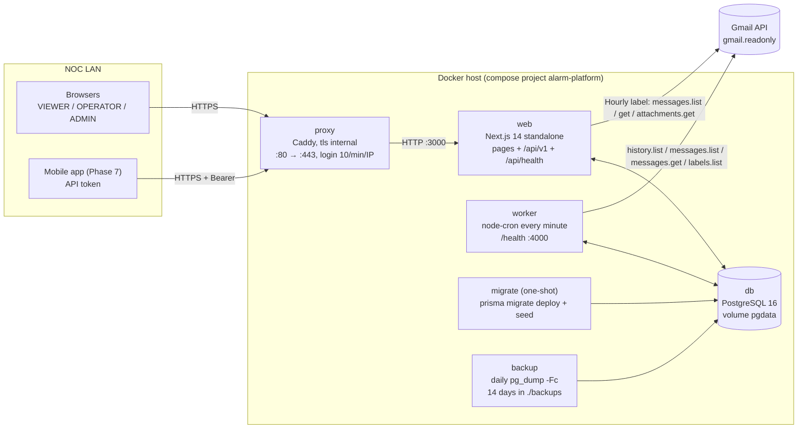
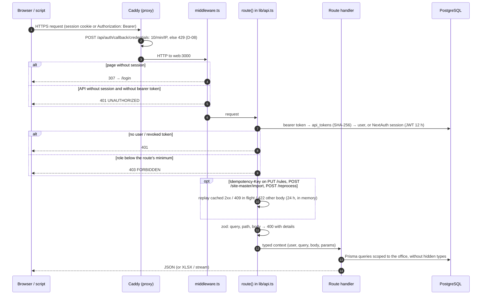
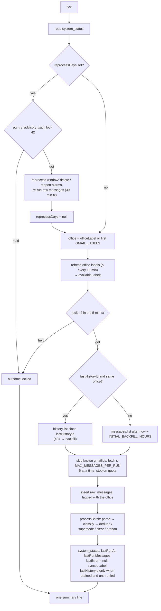
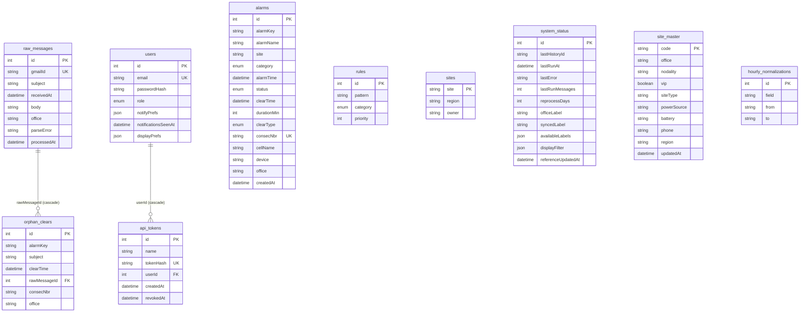
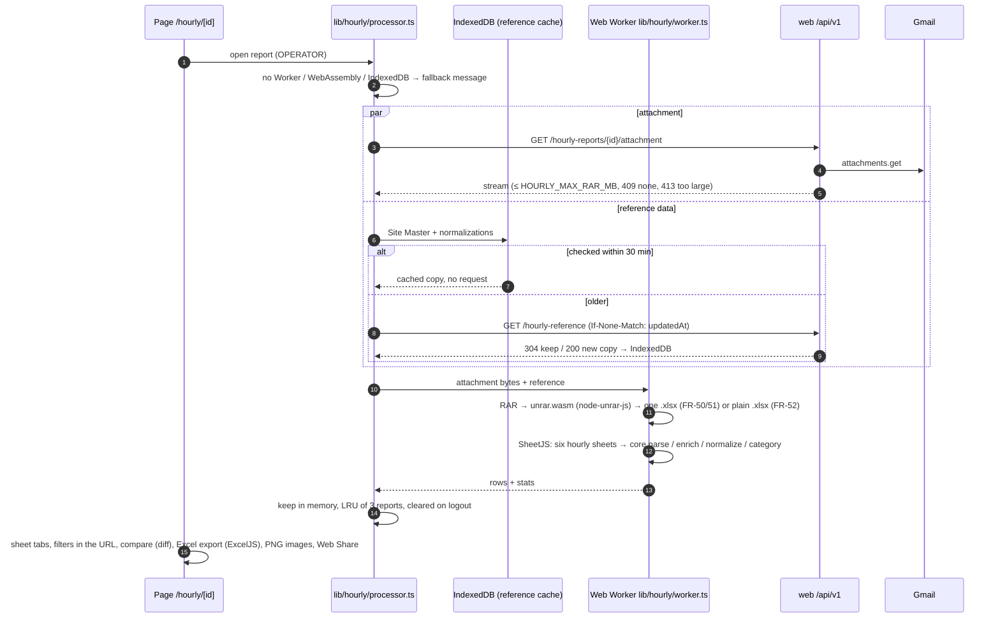

# Architecture

As built on 2026-10-18. Requirements: `REQUIREMENTS.md`; decisions: `docs/DECISIONS.md` (D-01…D-12
and the task clarifications); operations: `docs/RUNBOOK.md`. `tests/ci/docs.test.ts` checks that the
environment table below and `.env.example` match what the code reads.

## Components

One Docker host on the NOC LAN (A-02). Only the proxy publishes ports (NFR-26, D-06).

| Part | Code | Notes |
| --- | --- | --- |
| Core logic | `packages/core` | Parser, classification, matching engine, notifications, hourly processing; no database; `src/hourly` has zero Node imports (runs in the browser) |
| Database access | `packages/db` | Prisma schema, migrations, seed, repository |
| Worker | `apps/worker` | Gmail sync and the matching cycle |
| Web | `apps/web` | UI, `/api/v1` route handlers, OpenAPI, hourly browser pipeline |
| Proxy / backup | `proxy/`, `backup/`, `scripts/restore.sh` | Caddy with the caddy-ratelimit plugin; `pg_dump` loop; restore script |

## Request flow

Every `/api/v1` handler is built with `route()` (`apps/web/lib/api.ts`): authenticate, check the
minimum role, honour `Idempotency-Key` where enabled, validate with zod, run, and map errors to
`{ error: { code, message, details? } }`.

Sign-in goes through NextAuth credentials (`lib/auth.ts`): case-insensitive e-mail, bcrypt, lockout
after 5 failures for 15 minutes (`lib/lockout.ts`, per e-mail, in memory, single replica, D-04).

## Worker cycle

`apps/worker/src/index.ts` runs one cycle at start-up and then on `WORKER_CRON`; a tick is skipped
while the previous one runs. `run.ts` `runOnce`:

On any error the cycle stores `lastError` (≤ 2000 characters) and the next tick tries again.
`GET /health` on `WORKER_HEALTH_PORT` answers 503 when the last run is older than
`HEALTH_STALE_AFTER_SEC` or the database fails, else 200 (Gmail errors only in the body).

## Data model

`alarms` has no foreign key to `site_master`; list queries join on the site code (last `_` segment of
`site`, FR-32). Matching is global across offices (D-05). `sites` is not read or written. Times are
stored in UTC and shown in `ALARM_TZ` (NFR-29). Hourly alarm rows are never stored (NFR-28, D-10).

## Hourly reports in the browser

D-10: the server only streams the attachment; unrar, parsing, enrichment, filtering and export happen
in the browser, and no report is written to disk anywhere. The mobile app (no WebAssembly in Hermes)
uses `…/xlsx`, where the server extracts the workbook in memory (D-11).

## Environment variables

Defaults apply when the variable is unset. Compose passes these to the containers (`docker-compose.yml`).

| Variable | Default | Read by | Purpose |
| --- | --- | --- | --- |
| `POSTGRES_USER` | `alarms` | compose (db, backup, restore.sh) | Database user |
| `POSTGRES_PASSWORD` | required | compose (db, backup) | Database password |
| `POSTGRES_DB` | `alarms` | compose (db, backup, restore.sh) | Database name |
| `DATABASE_URL` | built by compose | Prisma (migrate, worker, web) | Connection string |
| `TEST_DATABASE_URL` | — | tests, Playwright, fixture guard | `alarms_test` only (NFR-41) |
| `ADMIN_EMAIL` | — | seed (migrate) | First ADMIN, created once |
| `ADMIN_PASSWORD` | — | seed (migrate) | First ADMIN password (≥ 8, else skipped) |
| `NEXTAUTH_SECRET` | required | web (boot check, NextAuth) | Session signing |
| `NEXTAUTH_URL` | `https://localhost` | NextAuth | Public URL of the web app |
| `SITE_ADDRESS` | `localhost` | proxy (Caddyfile) | Host name or IP for the internal certificate |
| `GOOGLE_CREDENTIALS_PATH` | required (worker) | worker, web | OAuth client file (read-only mount) |
| `GOOGLE_TOKEN_PATH` | required (worker) | worker, web | OAuth token file (read-only mount) |
| `GMAIL_LABELS` | — | worker, web | Office label read when none is selected (first entry) |
| `GMAIL_QUERY` | empty | worker | Extra filter for the backfill listing only |
| `OFFICE_LABEL_PARENTS` | `DN,DS` | worker | Parents of the office labels |
| `WORKER_CRON` | `* * * * *` | worker | Cycle schedule |
| `MAX_MESSAGES_PER_RUN` | `200` | worker | Messages fetched per cycle |
| `INITIAL_BACKFILL_HOURS` | `24` | worker | Backfill window |
| `WORKER_HEALTH_PORT` | `4000` | worker, compose healthcheck | `/health` port |
| `HEALTH_STALE_AFTER_SEC` | `300` | worker | `/health` 503 after this many seconds without a run |
| `ALARM_TZ` | `Africa/Cairo` | worker, web | Alarm time zone (DST-aware) |
| `ALERT_HOURS` | `4` | web | Overdue threshold |
| `WORKER_STALE_SEC` | `300` | web `/api/health` | Worker freshness in the health body |
| `HOURLY_GMAIL_LABEL` | `Hourly Update` | web | Label of the hourly report e-mails |
| `HOURLY_MAX_RAR_MB` | `25` | web (core `limitsFromEnv`) | Attachment size limit (RAR and plain XLSX) |
| `HOURLY_MAX_EXTRACT_MB` | `100` | web (core `limitsFromEnv`) | Declared uncompressed size limit |
| `HOURLY_GMAIL_MOCK_DIR` | — | web | Tests only: hourly reports from a local folder |
| `BACKUP_KEEP_DAYS` | `14` (fixed in compose) | backup | Days of dumps kept |
| `PGHOST` | `db` (fixed in compose) | backup | `pg_dump` connection |
| `PGUSER` | from `POSTGRES_USER` | backup | `pg_dump` connection |
| `PGPASSWORD` | from `POSTGRES_PASSWORD` | backup | `pg_dump` connection |
| `PGDATABASE` | from `POSTGRES_DB` | backup | `pg_dump` connection |
| `CI` | — | Vitest fixture guard | `true`: missing fixtures fail the run (P4-T03) |
| `NODE_ENV` | — | web `lib/db.ts` | Reuse one Prisma client across hot reloads outside production |
| `NEXT_DIST_DIR` | `.next` | `next.config.mjs` | Separate build folder for the e2e servers |
| `BUILD_STANDALONE` | — | `next.config.mjs` | `1` in the web image: standalone output |
| `INIT_CWD` | set by pnpm | worker `auth-cli.ts` (`pnpm gmail:auth`) | Base directory for relative OAuth file paths |
| `OPS_BASE_URL` | — | `tests/ops/stack.test.ts` | Live checks against a running stack |
| `OPS_RESTORE` | — | `tests/ops/stack.test.ts` | `1`: also run backup → restore |
| `OPS_PROJECT` | `alarm-platform` | `tests/ops/stack.test.ts` | Compose project of the live stack |
| `NODE_TLS_REJECT_UNAUTHORIZED` | — | `tests/ops/stack.test.ts` | Set to `0` there for Caddy's self-signed certificate |

Not environment variables in this build: `HOURLY_CACHE_MIN` (REQUIREMENTS §6) is the fixed 30-minute
reference-cache window in `apps/web/lib/hourly/reference.ts`; `HOURLY_UNRAR_BIN` is set in the web
image but not read (D-11: the server extracts with node-unrar-js).
